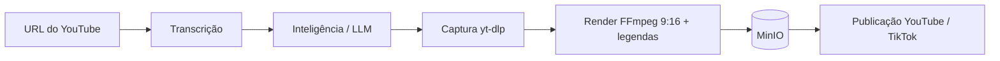

# Cuts

Plataforma para transformar vídeos longos do YouTube em **cortes verticais (9:16)** prontos para TikTok, YouTube Shorts e Reels. Uma IA analisa a transcrição, escolhe os melhores trechos, e o sistema baixa, recorta, legenda e publica, tudo num fluxo só.

O projeto também gera **vídeos narrados** a partir de um tema: roteiro por IA, voz sintética e B-roll de banco de imagens.

## Intenção

Criadores de conteúdo gastam horas garimpando momentos de podcasts, lives e aulas para viralizar em formato curto. O Cuts automatiza esse trabalho:

1. Você cola a URL de um vídeo.
2. A IA lê a transcrição e propõe cortes (com título, tags e hashtags).
3. Cada corte é baixado, convertido para vertical 1080×1920 e recebe legendas estilo "karaokê" (palavra destacada).
4. Você revisa e publica direto nas redes.

## Estrutura do monorepo

| Pasta | Descrição |
|---|---|
| [`api-cuts`](./api-cuts) | API em Node.js + Fastify (TypeScript) com todo o pipeline |
| [`front-cuts`](./front-cuts) | Interface web em React + Vite |

## Como funciona

### Pipeline de cortes (`POST /api/v1/pipeline`)

O progresso é enviado ao front por **SSE** (Server-Sent Events).



1. **Transcrição**: tenta primeiro `yt-dlp` (legendas `json3` com timing por palavra). Se falhar, usa a lib `youtube-transcript`. O resultado fica em cache no SQLite.
2. **Inteligência**: um LLM via OpenRouter recebe a transcrição e devolve os cortes (início, fim, título, tags, hashtags), respeitando as instruções do usuário, o número máximo de cortes e a duração alvo.
3. **Captura**: `yt-dlp` baixa apenas o trecho do corte e envia o arquivo bruto para o MinIO.
4. **Render**: FFmpeg converte para 1080×1920, grava legendas ASS com destaque de palavra e envia o resultado final ao MinIO.
5. **Publicação**: OAuth com YouTube e TikTok; histórico de posts por corte.

O pipeline tem dois modos:
- **Automático**: transcrição → IA → captura e render de cada corte sugerido.
- **Manual**: você informa início e fim; a IA é pulada e a transcrição só é buscada se as legendas estiverem ativas.

### Vídeos narrados (`POST /api/v1/narrated/generate`)

Tema → roteiro (Gemini) → áudio e legendas (Edge TTS) → B-roll (Pexels) → render FFmpeg vertical → MinIO.

### Endpoints principais (prefixo `/api/v1`)

| Método | Rota | Função |
|---|---|---|
| POST | `/pipeline` | Pipeline completo (SSE) |
| POST | `/transcription` | Transcrição de um vídeo |
| POST | `/intelligence` | Sugestão de cortes pela IA |
| POST | `/capture` | Baixa o trecho de um corte |
| POST | `/render` | Renderiza o corte vertical com legendas |
| GET/PATCH/DELETE | `/cuts`, `/cuts/:id` | Gerenciamento dos cortes |
| GET | `/social/auth/:platform` | Inicia OAuth (youtube/tiktok) |
| GET/DELETE | `/social/accounts` | Contas conectadas |
| POST | `/social/publish` | Publica um corte |
| GET | `/social/posts/:cutId` | Histórico de publicações |
| POST/GET | `/narrated/generate`, `/narrated` | Vídeos narrados |

## Stack

- **API**: Node.js 20+, Fastify, Zod, Drizzle ORM + SQLite (`better-sqlite3`), MinIO (armazenamento S3), FFmpeg, yt-dlp, Vitest
- **IA**: OpenRouter (cortes), Google Gemini (roteiros), Edge TTS (voz), Pexels (B-roll)
- **Front**: React 18, Vite 5, CSS Modules

## Requisitos

- Node.js 20+ e [pnpm](https://pnpm.io)
- FFmpeg (a API usa `ffmpeg-static`, mas o `yt-dlp` precisa de um FFmpeg disponível)
- Binário do `yt-dlp` (em `api-cuts/bin/` ou no `PATH`)
- MinIO rodando (via Docker Compose)
- Chaves das APIs usadas (veja abaixo)

## Configuração

```bash
cd api-cuts
cp .env.example .env
```

| Variável | Descrição |
|---|---|
| `PORT` | Porta da API (padrão `3000`) |
| `DATABASE_URL` | Caminho do SQLite (ex.: `./data/api-cuts.db`) |
| `MINIO_*` | Endpoint, porta, credenciais, bucket e SSL do MinIO |
| `OPENROUTER_API_KEY` / `OPENROUTER_MODEL` | LLM que escolhe os cortes |
| `GEMINI_API_KEY` | Roteiros dos vídeos narrados |
| `PEXELS_API_KEY` | B-roll dos vídeos narrados |
| `YOUTUBE_CLIENT_ID` / `YOUTUBE_CLIENT_SECRET` | OAuth do YouTube |
| `TIKTOK_CLIENT_KEY` / `TIKTOK_CLIENT_SECRET` | OAuth do TikTok |
| `FRONTEND_URL` / `API_URL` | URLs usadas nos redirecionamentos OAuth |

> Nunca faça commit do `.env` nem de arquivos `*.db`; ambos estão no `.gitignore`.

## Rodando em desenvolvimento

```bash
# 1. Dependências
cd api-cuts && pnpm install
cd ../front-cuts && pnpm install

# 2. Suba o MinIO (a partir de api-cuts)
docker compose up -d minio

# 3. API (http://localhost:3000)
cd api-cuts && pnpm run dev

# 4. Front (http://localhost:5173)
cd front-cuts && pnpm run dev
```

O Vite faz proxy de `/api` para `http://localhost:3000`.

> Se aparecer `Could not locate the bindings file` (`better-sqlite3`), rode `pnpm rebuild better-sqlite3`.

## Docker

```bash
cd api-cuts
docker compose up --build
```

Sobe a API (porta 3000) e o MinIO (API na 9000, console na 9001), com volumes para SQLite, MinIO e downloads temporários.

## Scripts da API

| Comando | Descrição |
|---|---|
| `pnpm run dev` | Servidor em modo watch |
| `pnpm run build` | Compila TypeScript para `dist/` |
| `pnpm start` | Roda a versão compilada |
| `pnpm test` | Testes (Vitest) |
| `pnpm run db:generate` / `db:migrate` | Migrações do Drizzle |

## Banco de dados

Tabelas SQLite: `transcriptions` (cache), `cuts`, `narrated_videos`, `social_accounts`, `social_posts`. Status de um corte: `processing → captured → rendered | failed`.

## Aviso

Baixe e republique somente conteúdo que você tem direito de usar. Respeite os termos de uso do YouTube e do TikTok e os direitos autorais dos criadores originais.

